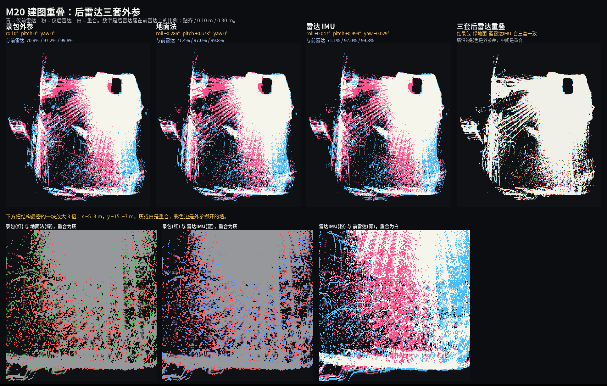

# M20 机器狗外参标定

前后两台 RoboSense Airy 的外参用实车 rosbag 核对过。前雷达是基准，平移用 CAD。后雷达的旋转用两路雷达 IMU 的相对姿态，再和 iKalibr、地面夹角、地图配准做了一次加权综合。综合结果与写入值一致，外参保持不变。

标定日期：2026-10-29  
数据包：`rosbag2_2026_10_28-05_54_03`（时长 152.9 s）  
外参文件：`rslidar_ws/src/rslidar_sdk/config/config.yaml`

## 1. 结论

后雷达相对录包外参的车体修正为：

- roll +0.047°
- pitch +0.999°
- yaw −0.029°

修正幅度 1.000°。旋转中心是后雷达原点 (−0.32028, 0, −0.013)。x、y、z 以及前雷达的 roll、pitch、yaw 保持原值。

四套估计换到同一个旋转上之后，加权结果是 roll +0.14° ± 0.09°、pitch +0.98° ± 0.04°、yaw −0.10° ± 0.10°。与上面这一组的差别落在 1 倍标准差里，所以驱动里的角度不改。pitch 的 ±0.04° 是陀螺采样的散差；iKalibr 加入加速度后，pitch 会在 +0.86° 和 +1.27° 之间移动，方法之间大约还有 0.2°。

这套外参用于建图已经够。残余旋转约 0.1°，10 m 处约 1.7 cm，20 m 处约 3.5 cm。0.30 m 栅格上后雷达与前雷达重合 99.8%。重新启动 `rslidar_sdk` 后，组播点云使用新角度。组播地址、端口和话题没有改。

驱动的 pitch 在 −90° 附近。yaml 里后雷达的 roll、yaw 约为 ±2.70°，再叠加 pitch 从 −90.000° 到 −89.000°，合起来就是这一次 1.000° 车体旋转。安装位置没有转过 2.7°。

## 2. 写入的外参

旋转顺序与 RoboSense 驱动一致：`R = Rz(yaw) * Ry(pitch) * Rx(roll)`。平移单位是米，角度单位是弧度。`R_new = R_corr * R_old`，`R_old` 是录包时的后雷达外参（roll 0、pitch −1.570795、yaw 0）。前雷达 yaw 为 π，后雷达在车体里仍朝后。

| 雷达 | 组播地址 | 话题 | x, y, z (m) | roll, pitch, yaw (rad) |
|---|---|---|---|---|
| 前 Airy | 224.10.10.201 | `/rslidar_points_front` | 0.32028, 0, -0.013 | 0, -1.570795, 3.1415926 |
| 后 Airy | 224.10.10.202 | `/rslidar_points_rear` | -0.32028, 0, -0.013 | 0.04712134, -1.55334372, -0.04763421 |

后雷达：

```yaml
x: -0.32028
y: 0.0
z: -0.013
roll: 0.04712134
pitch: -1.55334372
yaw: -0.04763421
```

前雷达：

```yaml
x: 0.32028
y: 0.0
z: -0.013
roll: 0.0
pitch: -1.570795
yaw: 3.1415926
```

用后雷达这三个角度反推回车体坐标系，得到 roll +0.0471°、pitch +0.9988°、yaw −0.0290°。`ENABLE_TRANSFORM` 已经打开，只改角度，不必重新编译。参数在驱动启动时读入，已录制的 bag 仍是录包当时的外参。

## 3. 综合

各套结果都写成「加在后雷达点云上」的车体旋转。陀螺 Kabsch 用角速度大于 0.05 rad/s 的 11223 个样本，并减去静止段零偏。iKalibr 的旋转已乘到与它相同的方向。地面法只提供滚转和俯仰，地图配准只提供 yaw。加权最小二乘按各自的协方差相加。

| 来源 | roll | pitch | yaw | 不确定度 |
|---|---:|---:|---:|---|
| 雷达 IMU 陀螺 Kabsch | +0.132° | +0.983° | −0.089° | 1 秒分块，σ = 0.10°、0.04°、0.12° |
| 写入值 | +0.047° | +0.999° | −0.029° | 与上一行是同一次对齐的两次实现，pitch 差 0.016° |
| iKalibr，只用陀螺 | +0.222° | +0.862° | −0.113° | 加入加速度后 pitch 移到 +1.272°，阶段差约 0.4° |
| 地面夹角 | −0.286° | +0.573° | — | σ = 0.6°。近处 0.8–3.5 m 的地面原先只差 0.11°，加上这组旋转后变为 0.75° |
| 地图配准 | — | — | −0.32° | σ = 0.25°，与里程计重复运行的散差同级 |

只用两路 IMU 时，综合值为 roll +0.14°、pitch +0.98°、yaw −0.10°。加上地面和地图 yaw 后，yaw 变为 −0.13°，pitch 仍是 +0.98°。

平移保持 CAD。这段轨迹长约 19 m，主要是约 168° 的转身，杆臂分不出来。iKalibr 的位置和 CAD 差几厘米，地图配准平移为 2.8 cm、2.4 cm、−0.9 cm，都和轨迹散差同级。

## 4. 建图核对

单帧里两台半球雷达几乎没有公共视场，前雷达主要看见 +X，后雷达主要看见 −X。车体走完这一段后，两边先后扫过同一片环境。

各自用雷达内置 IMU 做 FAST-LIO，不用车体 `/IMU`。点云已经在车体坐标系，FAST-LIO 只把车体 +Z 转到雷达 IMU 的 −Y，在线外参估计关闭。各保留 1525 / 1528 帧：

| 项目 | 前雷达 IMU201 | 后雷达 IMU202 |
|---|---|---|
| 轨迹长度 | 18.73 m | 18.94 m |
| 航向变化 | 168.0° | 168.8° |

变回初始车体坐标系后：

- 位姿差平均 5.5 cm，90% 的帧小于 7.8 cm，最大 14.5 cm。平均偏差约 x +0.1 cm、y −2.4 cm、z +1.8 cm。
- 0.3 m 体素的地图重合率：配准前 98.7%，配准后 99.0%。
- 后雷达地图配到前雷达地图：yaw −0.32°，平移 2.8 cm、2.4 cm、−0.9 cm，均方距离 3.4 cm。

下图用同一条前雷达轨迹，把后雷达分别按录包外参、地面法和写入的雷达 IMU 外参投影到 0.05 m 栅格。青是只有前雷达打到的格子，粉是只有后雷达打到的，白是重合。第四张里红、绿、蓝分别是三套后雷达外参，白是三套一致。



| 后雷达外参 | 与前雷达重合：贴齐 / 0.10 m / 0.30 m |
|---|---|
| 录包外参，修正 0° | 70.9% / 97.2% / 99.8% |
| 地面法，0.640° | 71.4% / 97.0% / 99.8% |
| 雷达 IMU，1.000° | 71.1% / 97.0% / 99.8% |

0.30 m 上三套同为 99.8%。1° 的修正表现为墙沿上的一条色边，不改变占据栅格。贴齐的 5 cm 格子大约 71%，其余是两边半球视野和轨迹散差留下的格子。

两路雷达 IMU 相对整数轴向的残余：

| 雷达 | roll | pitch | yaw | 总角度 |
|---|---|---|---|---|
| 前 IMU201 | −0.73° | −1.10° | −0.11° | 1.31° |
| 后 IMU202 | −0.68° | −0.10° | −0.14° | 0.68° |
| 后相对前 | +0.047° | +0.999° | −0.029° | 1.000° |

后相对前的 1.000° 是写入值。两路 IMU 互相之间的转角是 179.97°，对应前后雷达朝向相反。各 IMU 相对整数轴的 1° 左右是轴向约定的残余，相对旋转里已经相减掉，没有再写入前雷达。

## 5. 录包内容

驱动编译时打开了 `ENABLE_TRANSFORM`。两台雷达都是 RSAIRY，点云字段为 `x y z intensity ring timestamp`，约 10 Hz，96 线。

| 话题 | 类型 | 条数 | 说明 |
|---|---|---|---|
| `/rslidar_points_front` | PointCloud2 | 1528 | 前雷达，已做外参变换 |
| `/rslidar_points_rear` | PointCloud2 | 1528 | 后雷达，已做外参变换 |
| `/IMU` | Imu | 30585 | 车体 IMU，200 Hz，加速度 m/s²，静止时重力在 +Z |
| `/LIDAR/IMU201` | Imu | 30558 | 前雷达内置 IMU，单位约 g，重力在 −Y |
| `/LIDAR/IMU202` | Imu | 30558 | 后雷达内置 IMU，单位约 g，重力在 −Y |

三路 IMU 的角速度对齐，滞后为 0。点云头时间与雷达 IMU 使用同一套时钟。

## 6. 复现

```bash
source /opt/ros/foxy/setup.bash
source ~/fast_lio_ws/install/setup.bash

# 前雷达，IMU 用 /LIDAR/IMU201
ros2 run fast_lio fastlio_mapping --ros-args \
  --params-file ~/M20外参标定/m20_front_lidar_imu.yaml
ros2 bag play ~/M20_bag/rosbag2_2026_10_28-05_54_03 \
  --topics /rslidar_points_front /LIDAR/IMU201

# 后雷达换成 m20_rear_lidar_imu.yaml，话题换成 /rslidar_points_rear 和 /LIDAR/IMU202
```

两份配置里 `extrinsic_est_en` 为 false。前雷达 `extrinsic_T` 为 `[0, -0.013, 0.32028]`，`extrinsic_R` 把车体 +Z 转到 IMU −Y。后雷达的 `extrinsic_R` 再绕竖轴转 180°。比较前要把 FAST-LIO 的 IMU 轨迹乘回车体坐标系。FAST-LIO 使用 hku-mars 仓库的 `ROS2` 分支，`lidar_type: 5`，点云时间戳单位为秒。
